# Listick

Track what you watch: movies, shows and anime. History, ratings, smart lists, Up next, Continue watching, an airing calendar,
stats, tracking from Stremio, Jellyfin and Seanime, anime progress synced to AniList and MyAnimeList, and imports from Trakt,
Simkl, Letterboxd, MyAnimeList, AniList and Kitsu.
Self-hosted, with invite-only sign-up, so you can share it with family and friends.

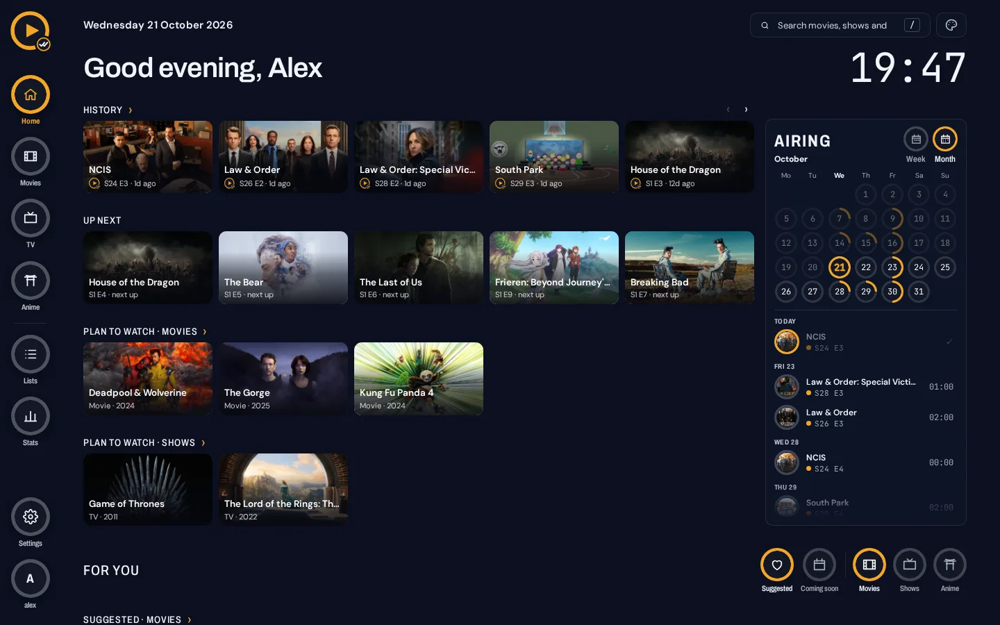

<p>
  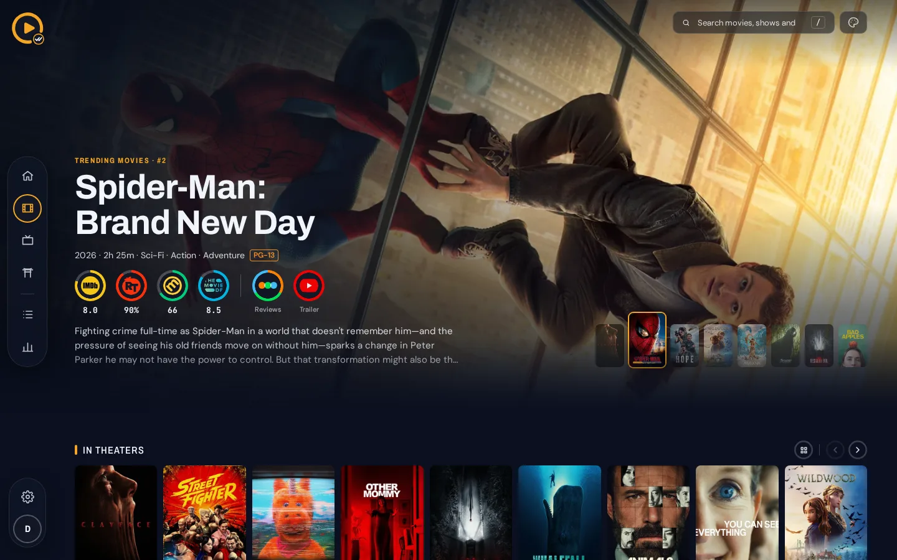
  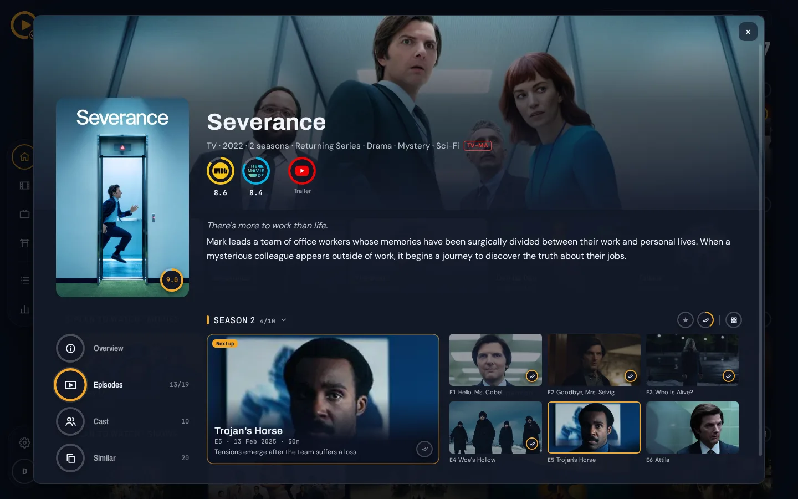
  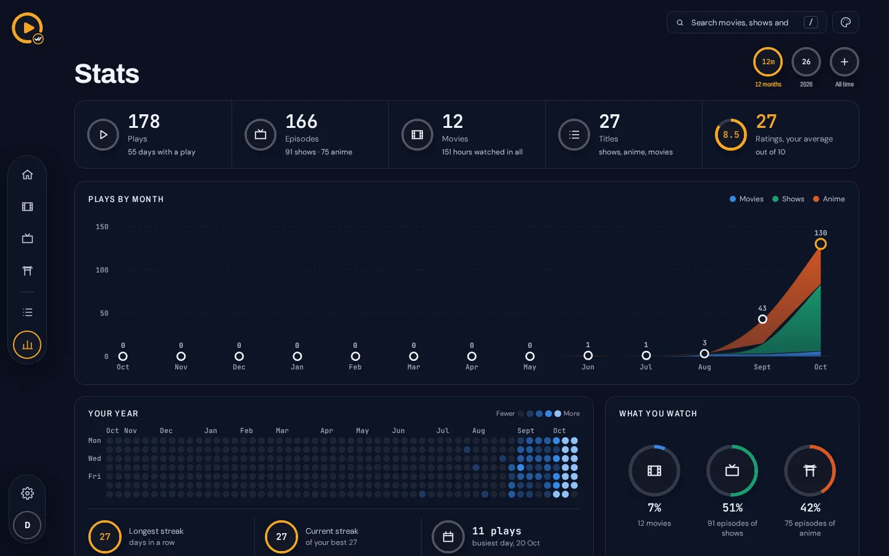
  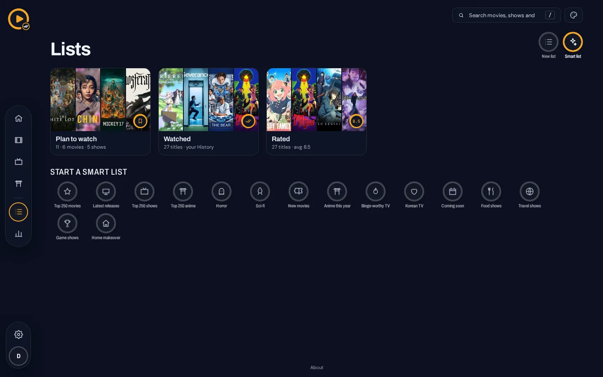
</p>
<p>
  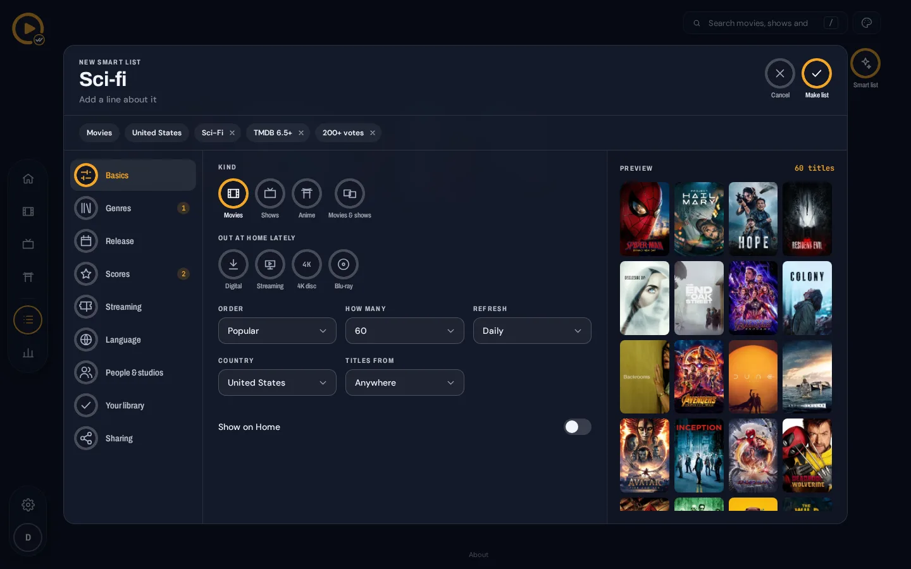
  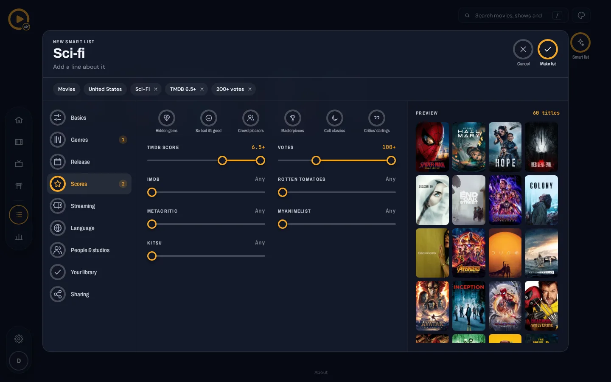
  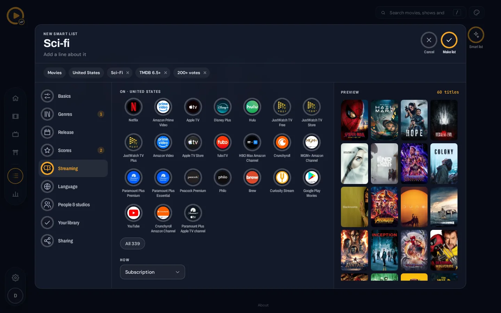
</p>
<p align="center">
  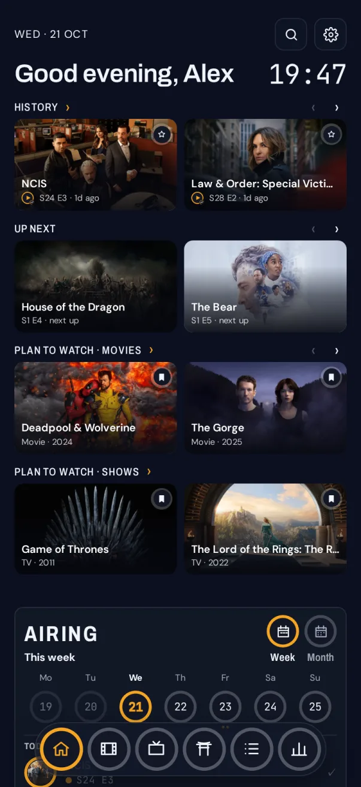
  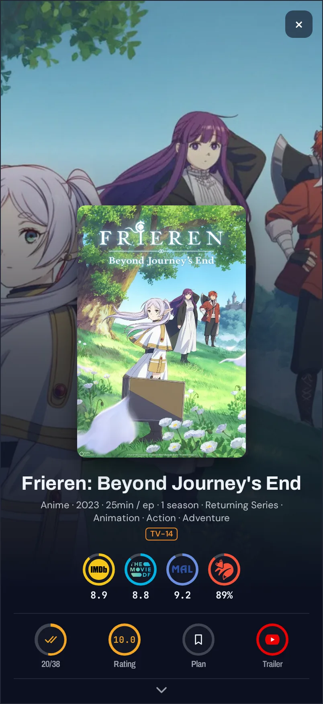
  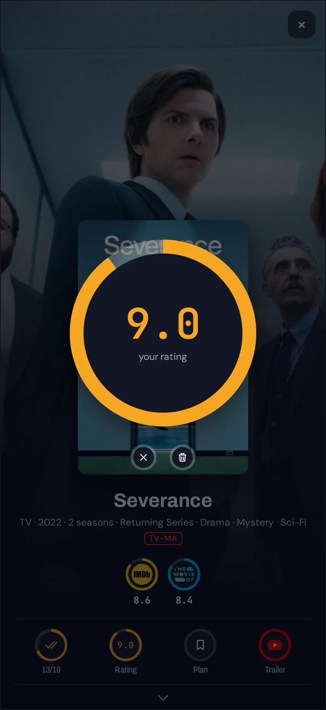
  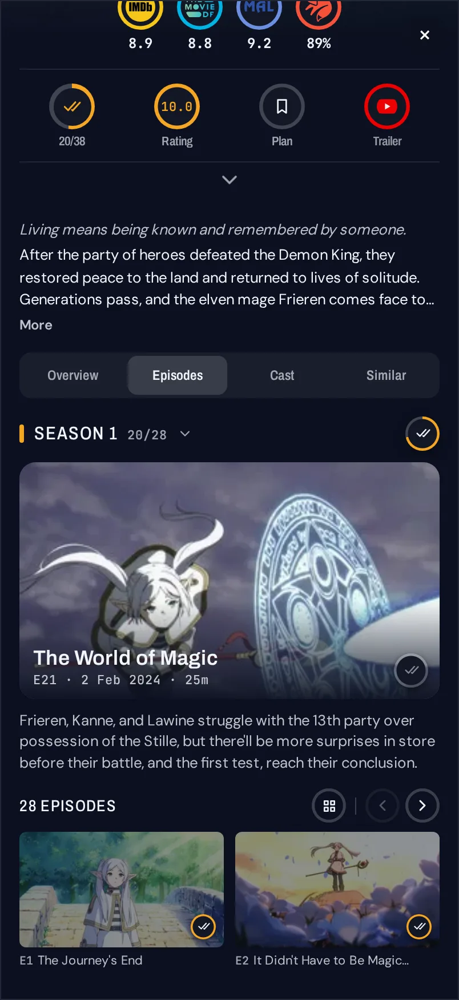
</p>

## Requirements

- Docker with Compose v2 (images for `linux/amd64` and `linux/arm64`)
- A free [TMDB API Read Access Token](https://www.themoviedb.org/settings/api)
- About 512 MB of free memory and 1 GB of disk

## Install

1. Download [`compose.yaml`](compose.yaml) and [`.env.example`](.env.example) into an empty folder.
2. `cp .env.example .env` and set `TMDB_ACCESS_TOKEN`.
3. `docker compose up -d`
4. Open http://localhost:3000 and create your account. The first account is the admin; invite others from Settings › Users.

Every other setting is optional and described in [`.env.example`](.env.example).

## On the internet

- Put it behind a reverse proxy with HTTPS, and don't expose port 3000 directly.
- Set `APP_ORIGIN` to your URL, for example `https://listick.example.com`.
- Set `LISTICK_OWNER_NAME` and `LISTICK_OWNER_PASSWORD` before the first start, so nobody else can claim the admin account.
- Behind more than one proxy (for example Cloudflare and then your own), set `LISTICK_TRUSTED_PROXIES=2`.

## On a VPS

Debian 13 or Ubuntu 24.04, with a domain pointing at the server.

```bash
curl -fsSL https://get.docker.com | sh
sudo apt install caddy
mkdir listick && cd listick
curl -fsSLO https://raw.githubusercontent.com/listicktv/listick/main/compose.yaml
curl -fsSL https://raw.githubusercontent.com/listicktv/listick/main/.env.example -o .env
```

1. In `.env`, set `TMDB_ACCESS_TOKEN`, `APP_ORIGIN=https://listick.example.com`, `LISTICK_OWNER_NAME`,
   `LISTICK_OWNER_PASSWORD` and `POSTGRES_PASSWORD`.
2. In `compose.yaml`, change the port to `"127.0.0.1:3000:3000"`.
3. Replace `/etc/caddy/Caddyfile` with:
   ```
   listick.example.com {
       reverse_proxy 127.0.0.1:3000
   }
   ```
4. `sudo systemctl reload caddy && docker compose up -d`

## AniList and MyAnimeList Sync

Settings › Connections › AniList or MyAnimeList: connect, then **Sync now** copies your anime progress from History to
that list, with started and completed dates. An entry is only raised (more episodes, or Completed), never lowered.

- AniList: an API client at [anilist.co/settings/developer](https://anilist.co/settings/developer) with the redirect URL
  `<APP_ORIGIN>/api/lists/done/anilist`; set `ANILIST_CLIENT_ID` and `ANILIST_CLIENT_SECRET`.
- MyAnimeList: an app at [myanimelist.net/apiconfig](https://myanimelist.net/apiconfig) with the redirect URL
  `<APP_ORIGIN>/api/lists/done/mal`; set `MAL_CLIENT_ID`, and `MAL_CLIENT_SECRET` for a web-type app.

## Update and back up

```bash
docker compose pull && docker compose up -d                              # update
docker compose exec db pg_dump -U listick listick > listick.sql          # back up
```

Releases and what changed: [releases](https://github.com/listicktv/listick/releases). To use your own Postgres, remove the
`db` service from `compose.yaml` and set `DATABASE_URL`.

## More

[API for addons](docs/api.md) · [Credits](CREDITS.md) · [Development](docs/development.md) · [Security](SECURITY.md)

## Support

Listick is free and built in spare time. If you find it useful:

- ⭐ Star this repository
- 🐞 Report bugs or suggest features in [issues](https://github.com/listicktv/listick/issues)
- 🤝 Contribute: pull requests are welcome ([development guide](docs/development.md))
- ☕ Donate on [Ko-fi](https://ko-fi.com/listicktv)

## Disclaimer

Listick keeps track of what you watch and shows information about titles. It does not host, stream or distribute any
video. Titles, images and scores come from third-party services (see [Credits](CREDITS.md)) and belong to their owners.
You are responsible for using Listick, and any service you connect to it, in line with their terms and the laws that apply
to you.

Licence: [AGPL-3.0](LICENSE).
